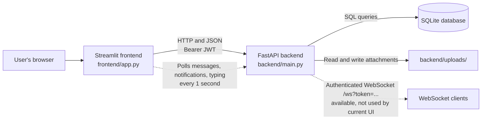

<div align="center">
  <h1>LANChat</h1>
  <p><strong>Messaging and file sharing, built around a clear client-server design.</strong></p>
  <p>A Python project that brings public chat, direct messages, and invite-only groups into one Streamlit interface.</p>
  <p>
    
    
    
    
  </p>
</div>

LANChat is a real-time messaging and file-sharing application built using a client-server architecture. It was developed as a Data Communications course project to demonstrate how a user interface, an HTTP API, authentication, persistent storage, and network communication fit together in a working application.

The Streamlit frontend sends HTTP requests to a FastAPI backend. The backend validates users and messages, stores application data in SQLite, and writes uploaded files to disk. In the current frontend, new-message updates are delivered through one-second polling. The backend also implements an authenticated WebSocket endpoint, but the Streamlit frontend does not currently connect to it.

> LANChat is a client-server application. It is not a peer-to-peer or decentralized system, and the local setup requires both services to be running.

## Contents

- [Project overview](#project-overview)
- [Features](#features)
- [Screenshots](#screenshots)
- [Technology stack](#technology-stack)
- [Architecture](#architecture)
- [Project structure](#project-structure)
- [Prerequisites](#prerequisites)
- [Local setup](#local-setup-windows-powershell)
- [Configuration](#configuration)
- [Docker](#docker)
- [Using the application](#using-the-application)
- [API documentation](#api-documentation)
- [Database and file storage](#database-and-file-storage)
- [Security notes](#security-notes)
- [Troubleshooting](#troubleshooting)
- [Development and contributions](#development-and-contributions)
- [Future ideas](#future-ideas)
- [License](#license)
- [Acknowledgements](#acknowledgements)

## Project overview

LANChat provides a shared public conversation, one-to-one direct messages, and private group conversations. Users register with a username and password, then use a browser-based Streamlit interface to send messages, search conversation history, and share supported files.

The project demonstrates a conventional client-server workflow: the frontend communicates with a backend API, the backend authenticates requests and applies access checks, and SQLite and the local filesystem hold persistent data. The included local setup is intended for development and coursework demonstrations.

## Features

- **Registration and login:** usernames and passwords are validated by the API; passwords are stored as bcrypt hashes.
- **Public chat:** authenticated users can read and post in the public conversation.
- **Direct messages:** private one-to-one conversations between registered users.
- **Invite-only groups:** create a named group and invite existing users. Group messages and files are restricted to members.
- **Persistent message history:** messages are stored in SQLite. Users can edit or soft-delete their own messages.
- **Search:** search the current conversation or search across public chat, the caller's groups, and direct messages.
- **File sharing:** upload supported images and documents to a conversation. Images and videos can be previewed in the chat; attachments can be downloaded. The backend accepts a defined type and extension allow-list and limits uploads to 25 MiB.
- **Near-real-time updates:** the Streamlit UI polls message and notification endpoints every second. It also reports typing activity and direct-message read receipts.
- **Backend WebSocket endpoint:** FastAPI exposes an authenticated `/ws` endpoint and broadcasts messages to connected clients. The current Streamlit UI does not use this endpoint; its updates come from polling.
- **Optional SSO placeholder:** when `ENABLE_OAUTH` is enabled, the UI can display a disabled SSO button. No external SSO provider is implemented.

## Screenshots

There are no application screenshots checked into this repository. Add genuine screenshots of the running application to a `screenshots/` directory if you want to include them here. For example, after adding `screenshots/login.png`, reference it with the relative path ``. Do not use sample or unrelated images as application screenshots.

## Technology stack

| Technology | Role | Repository details |
|---|---|---|
| Python | Application language | The Docker image uses Python 3.11; the Render blueprint selects Python 3.12.7. |
| Streamlit | Frontend | `frontend/app.py` renders login, registration, conversations, search, uploads, and the chat interface. |
| FastAPI | Backend API | `backend/main.py` implements the HTTP routes, file handling, notifications, typing status, and WebSocket endpoint. |
| Uvicorn | ASGI server | Runs the FastAPI application locally on port 8000. |
| SQLite | Relational storage | `backend/database.py` creates and accesses the database. Tables are initialized at backend startup. |
| bcrypt | Password hashing | Passwords are hashed and checked in `backend/auth.py`. |
| JWT (`python-jose`) | Authentication tokens | Signed tokens are used by protected HTTP routes and the WebSocket endpoint. |
| Pydantic | Data validation | `backend/models.py` defines validated request and response models. |
| Requests | Frontend-to-backend HTTP | The Streamlit Python process calls the API with `requests`. |
| Docker Compose | Optional containers | A Dockerfile and a two-service Compose configuration are present; see the current limitations in [Docker](#docker). |

`requirements.txt` lists the dependencies without version pins. The version badges above describe the frameworks used, not a lockfile or a guarantee of identical versions across installations.

## Architecture



The Streamlit process makes backend calls using Python `requests`; browser interactions trigger Streamlit reruns. Message and notification fragments poll the API at a one-second interval. Separately, the backend can broadcast message changes over its authenticated WebSocket route to any connected client that implements that protocol.

## Project structure

```text
LANChat/
|-- .streamlit/
|   `-- config.toml          Streamlit server and theme settings
|-- backend/
|   |-- auth.py              bcrypt hashing and JWT validation
|   |-- database.py          SQLite initialization and data access
|   |-- main.py              FastAPI routes, WebSocket, uploads, access checks
|   `-- models.py            Pydantic request and response models
|-- frontend/
|   `-- app.py               Streamlit application
|-- .env.example             Example backend environment configuration
|-- .gitignore               Excludes local secrets and runtime data
|-- Dockerfile               Container image definition
|-- docker-compose.yml       Optional backend/frontend Compose services
|-- render.yaml              Render service blueprint
|-- requirements.txt         Python dependencies
`-- README.md
```

At runtime, the backend creates `backend/chat_db.sqlite` when that is the configured database path and creates `backend/uploads/` for uploaded attachments. A local `.env` file is created from `.env.example`; it is excluded by `.gitignore`. These runtime/local files are not part of the source tree shown above.

## Prerequisites

Required for the local setup:

- Git
- Python 3.11 or newer and `pip`
- Windows PowerShell (commands below use PowerShell syntax)
- A browser

Docker Desktop with Docker Compose is optional. The included Compose configuration currently has end-to-end issues described below, so the local Python setup is the recommended way to run the application as checked in.

## Local setup (Windows PowerShell)

### 1. Clone the repository

```powershell
git clone https://github.com/rajaspatil1105/LANchat.git
Set-Location LANchat
```

### 2. Create and activate a virtual environment

```powershell
python -m venv .venv
.\.venv\Scripts\Activate.ps1
```

If PowerShell blocks activation, allow scripts for this terminal session and retry:

```powershell
Set-ExecutionPolicy -Scope Process -ExecutionPolicy Bypass
.\.venv\Scripts\Activate.ps1
```

### 3. Install the dependencies

```powershell
python -m pip install --upgrade pip
pip install -r requirements.txt
```

### 4. Configure the backend secret

Copy the example file and open it for editing:

```powershell
Copy-Item .env.example .env
notepad .env
```

Generate a strong key:

```powershell
python -c "import secrets; print(secrets.token_hex(32))"
```

Replace the example `SECRET_KEY` value in `.env` with the generated value, then save the file. The backend refuses to start when the secret is missing or still set to the example placeholder. Keep `.env` private and do not commit it.

The database tables are created automatically when the backend starts. With the example configuration, the database file is `backend/chat_db.sqlite`; the backend does not require a separate migration command for a fresh database.

### 5. Start the backend

In the first PowerShell terminal, from the repository root with the virtual environment active:

```powershell
uvicorn backend.main:app --reload --port 8000
```

### 6. Start the frontend

Open a second PowerShell terminal, change to the repository root, activate the same environment, and run:

```powershell
Set-Location LANChat
.\.venv\Scripts\Activate.ps1
streamlit run frontend/app.py
```

The frontend defaults to the backend URL `http://127.0.0.1:8000`. If the backend is running on another address, set `SIMPLECHAT_API_URL` in the frontend terminal before starting Streamlit, for example:

```powershell
$env:SIMPLECHAT_API_URL = "http://127.0.0.1:8001"
```

### 7. Open LANChat

- Streamlit application: <http://localhost:8501>
- FastAPI interactive documentation: <http://localhost:8000/docs>
- FastAPI health response: <http://localhost:8000/>

Register an account from the app, then log in to use the conversations.

## Configuration

The backend loads `.env` with `python-dotenv`. The Streamlit frontend reads its API base URL from its process environment and falls back to the default shown below.

| Variable | Purpose | Required? | Default or configured value |
|---|---|---:|---|
| `SECRET_KEY` | Signs JWT access tokens. | Yes | No default. `.env.example` contains a placeholder that must be replaced. |
| `ALGORITHM` | JWT signing algorithm. | No | `HS256` |
| `ACCESS_TOKEN_EXPIRE_MINUTES` | Token lifetime in minutes. | No | `60` |
| `DATABASE_URL` | SQLite file path. Relative paths are resolved from the project root. | No | `backend/chat_db.sqlite` when unset; `.env.example` sets this same path. |
| `ENABLE_OAUTH` | Controls whether the disabled SSO placeholder is advertised to the UI. | No | `false` |
| `ALLOWED_ORIGINS` | Comma-separated additional CORS origins. The backend also includes `http://localhost:8501` and `http://127.0.0.1:8501`. | No | Empty (only built-in origins are used). |
| `SIMPLECHAT_API_URL` | Backend base URL used by the Streamlit process. | No | `http://127.0.0.1:8000` |
| `PYTHON_VERSION` | Python version selected by the Render blueprint. | No | `3.12.7` in `render.yaml`; not an application setting. |
| `PORT` | Port supplied to the start commands by a hosting platform such as Render. | Platform-provided | No local default; local commands use 8000 and 8501. |

For local development, only `SECRET_KEY` needs to be changed from the example. The other `.env.example` values are suitable for a basic local run. If a port or host changes, update the corresponding service command and frontend API URL.

## Docker

A `Dockerfile` and `docker-compose.yml` are included, but the Compose setup is **not ready for a reliable end-to-end run as currently configured**:

1. Compose runs the backend and frontend in separate containers, while the frontend is configured with `SIMPLECHAT_API_URL=http://127.0.0.1:8000`. From the frontend container, that address points back to the frontend container rather than the backend service.
2. Compose persists the SQLite database in a named volume, but it does not mount the backend's `backend/uploads/` directory. Uploaded files therefore are not persisted with that volume if the container is replaced.

The Compose file also requires a real `SECRET_KEY` in the root `.env`. Because the service URL and attachment persistence need configuration changes, this README does not present `docker compose up` as a working deployment command. The standard local Python setup above is the verified-by-code startup path; container behavior has not been run as part of this README update.

The Dockerfile is based on Python 3.11, exposes ports 8000 and 8501, and defaults to starting Uvicorn. Compose defines separate backend and Streamlit services.

## Using the application

1. Start the backend and Streamlit frontend as described in [Local setup](#local-setup-windows-powershell).
2. Open <http://localhost:8501> and choose **Create one** to register. Usernames must be 3–50 characters using letters, digits, `_`, `.`, or `-`; passwords must be 6–128 characters.
3. Log in with the account you created.
4. Select **Public** to use the shared public conversation.
5. Select a username under **Direct messages** to open a one-to-one conversation.
6. Use **New group** to create an invite-only group and select existing users to invite.
7. Use the search controls to search the open conversation or all conversations available to your account.
8. Use the attachment control in the message composer to share an allowed file. Supported formats include PNG/JPEG/GIF/WebP images, PDF, TXT, CSV, ZIP, DOC/DOCX, MP4, and WebM; each upload is limited to 25 MiB.
9. Use the message controls to edit or soft-delete your own messages. Use **Log out** in the sidebar to end the current app session.

## API documentation

FastAPI's interactive Swagger UI is available locally at <http://localhost:8000/docs>. The OpenAPI document is available at <http://localhost:8000/openapi.json>.

The main route groups are:

| Area | Routes |
|---|---|
| Health and authentication | `GET /`, `POST /auth/register`, `POST /auth/login`, `GET /auth/me`, `GET /auth/config` |
| Messages and users | `GET/POST /messages`, `GET /messages/direct`, `GET /users`, `GET /notifications` |
| Search | `GET /messages/search`, `GET /messages/search/all` |
| Attachments | `POST /messages/upload`, `GET /files/{message_id}` |
| Message actions | `PATCH/DELETE /messages/{message_id}`, `POST /messages/mark-read` |
| Groups | `GET/POST /groups`, `POST /groups/{group_id}/join` |
| Typing status | `POST /typing`, `GET /typing` |
| WebSocket | `WS /ws?token=<JWT>` |

Protected HTTP routes use `Authorization: Bearer <token>`. The WebSocket route authenticates with a JWT in its `token` query parameter. Consult `/docs` for parameters and request schemas rather than relying on this route summary as a complete API contract.

## Database and file storage

SQLite is initialized when FastAPI starts. `database.py` creates missing tables with `CREATE TABLE IF NOT EXISTS` and applies additive column checks for existing databases. With the sample configuration, the database is `backend/chat_db.sqlite`. Set `DATABASE_URL` to change it; relative paths are anchored at the repository root.

Uploaded files are stored under `backend/uploads/` using generated storage names, while message metadata is held in SQLite. Both locations are local filesystem data. `.gitignore` excludes the default database and upload directory from Git.

To back up local data, stop the backend first, then copy the configured SQLite file and the `backend/uploads/` directory to a safe location. If `DATABASE_URL` points elsewhere, back up that file instead. Do not delete the database or upload directory to troubleshoot unless you intend to permanently remove accounts, messages, groups, and attachments; there is no reset procedure in this README.

## Security notes

- Passwords are hashed with bcrypt; plaintext passwords are not stored.
- JWTs are signed with `SECRET_KEY`, use the configured algorithm, and expire after the configured number of minutes.
- Protected routes validate Bearer tokens. Group and direct-message access checks restrict messages and attachment downloads to the appropriate members or participants.
- Search uses parameterized database queries. Uploads are restricted by extension, content type, and a 25 MiB size limit.
- The frontend stores the login token in the URL query string so a refresh can restore the Streamlit session. Do not share a URL containing a `token` parameter; use **Log out** on shared devices.
- `.env` contains a signing secret and must not be committed. The repository's `.gitignore` excludes it.
- The local development commands use HTTP. The repository does not implement end-to-end encryption or establish TLS for arbitrary deployments. Do not treat this coursework configuration as a production security guarantee.

## Troubleshooting

| Problem | Checks |
|---|---|
| PowerShell will not activate `.venv` | Run `Set-ExecutionPolicy -Scope Process -ExecutionPolicy Bypass` in that terminal, then retry `\.\.\venv\Scripts\Activate.ps1`. |
| Backend stops with a `SECRET_KEY` error | Confirm the root `.env` exists and `SECRET_KEY` is a generated value, not `your_random_secret_key_here`. Restart Uvicorn after editing it. |
| Frontend says it cannot reach the backend | Confirm Uvicorn is running on port 8000. Check `SIMPLECHAT_API_URL`; its default is `http://127.0.0.1:8000`. |
| Port 8000 or 8501 is already in use | Stop the other process or select an available port. If the backend port changes, set `SIMPLECHAT_API_URL` in the frontend terminal to the matching backend URL. |
| Database cannot be opened | Check that the configured database parent directory exists and is writable. SQLite creates the database file, but it does not create missing parent directories. |
| File upload is rejected | Check that the extension and content type are supported and that the file is no larger than 25 MiB. Confirm `backend/uploads/` is writable. |
| Dependency installation fails | Confirm Python is 3.11 or newer, activate `.venv`, update `pip`, and rerun `pip install -r requirements.txt`. The requirements are not version-pinned. |
| API docs do not load | Confirm the backend started successfully and open `http://localhost:8000/docs` while it is running. |

## Development and contributions

For development, use the same virtual-environment and two-terminal setup described above. The frontend is in `frontend/app.py`; API routes and data handling are in `backend/`. Keep backend data in the configured SQLite file and upload directory, not in source control.

A typical contribution workflow is:

```powershell
git checkout -b feature/short-description
# Make and review your changes
git status
git diff
git add README.md
git commit -m "Describe the change"
```

Adjust the `git add` path to match the files you intend to contribute. No automated test suite or contribution policy is defined in the repository currently.

## Future ideas

These are possible future improvements, not implemented features:

- Connect the Streamlit interface to the backend WebSocket endpoint instead of polling.
- Correct the Compose service URL and persist uploads with a dedicated volume.
- Pin dependencies and add automated tests for authentication, authorization, and messaging.
- Add genuine screenshots and document a repeatable deployment configuration with persistent storage.

## License

No root-level license file is present in this repository. All rights and permissions should be treated as unspecified unless the project owner adds a license.

## Acknowledgements

LANChat is built with Python, Streamlit, FastAPI, Uvicorn, SQLite, bcrypt, Pydantic, Requests, and the libraries listed in `requirements.txt`.
